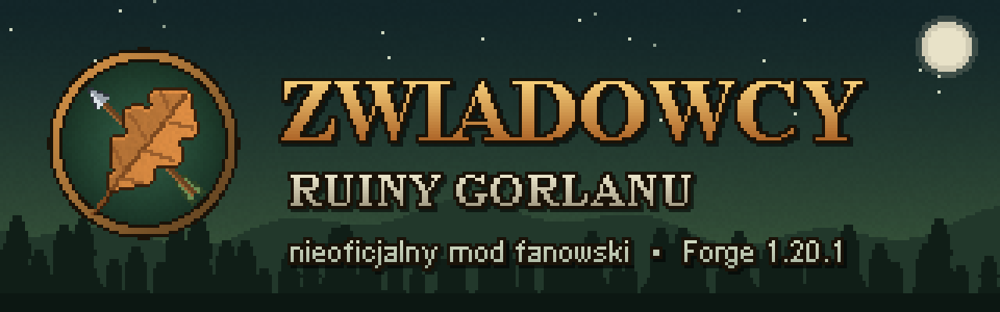

# Zwiadowcy: Ruiny Gorlanu



**Autorzy:** ABialas & 🤖CC

> **Nieoficjalny mod fanowski.** Mod powstał z sympatii do serii „Zwiadowcy” Johna Flanagana. Nie jest związany
> z autorem ani z wydawcami serii i nie jest przez nich zatwierdzony. Świat, postacie i nazwy należą do ich
> właścicieli. Mod jest darmowy i niekomercyjny, a dialogi i misje napisano od nowa, bez cytatów z książek.
> NIE JEST OFICJALNYM PRODUKTEM MINECRAFT. NIE JEST ZATWIERDZONY PRZEZ MOJANG ANI MICROSOFT ANI Z NIMI ZWIĄZANY.

Fabularny mod do Minecraft Java **1.20.1 (Forge 47.x)**, inspirowany pierwszym tomem „Zwiadowców” Johna Flanagana.
Grasz jako Will, podopieczny barona Aralda, który zostaje uczniem zwiadowcy Halta i staje do walki z Kalkarami Morgaratha.
Czeka na ciebie 14 misji fabularnych, nowy wymiar Araluen, skradanie się w płaszczu zwiadowcy, łuk, noże, koń Wyrwij,
bossowie i otwarty świat po zakończeniu kampanii. Cała fabuła, dialogi i opisy są po polsku.
*English summary at the end.*

## ⬇ Pobierz

**[Pobierz najnowszą wersję moda (Releases)](https://github.com/mbialkowski/minecraft-mod-zwiadowcy/releases/latest)**

W sekcji *Assets* wybierz jeden z plików:
- `zwiadowcy-forge-1.20.1-<wersja>.jar` - sam mod, ten plik wrzucasz do folderu `mods`,
- `Zwiadowcy-Ruiny-Gorlanu-<wersja>-forge-1.20.1.zip` - ten sam mod plus instrukcja i licencje.
  Zip trzeba najpierw rozpakować, a do `mods` trafia tylko plik `.jar`.

## Instalacja krok po kroku

**Potrzebujesz:** kupionego Minecraft Java Edition (konto Microsoft z grą) i komputera z co najmniej 8 GB RAM.
Wersja na konsole, telefony i „Bedrock” z Microsoft Store nie zadziała.

### Najprościej: launcher modów (zalecane)

Darmowe launchery modów same instalują Forge'a, więc wystarczy dodać do nich jeden plik. Wybierz jeden z nich.

**CurseForge App** ([curseforge.com/download/app](https://www.curseforge.com/download/app))
1. Zainstaluj aplikację, wybierz grę **Minecraft** i zaloguj się kontem Microsoft.
2. Kliknij **Create Custom Profile**. Wybierz wersję **1.20.1** i modloader **Forge** (najnowszy 47.x), potem **Create**.
3. Otwórz profil, kliknij **⋯** (trzy kropki) i **Open Folder**. Wrzuć pobrany plik `zwiadowcy-forge-1.20.1-<wersja>.jar`
   do folderu `mods`. Możesz też przeciągnąć plik na okno profilu.
4. Kliknij **Play**.

**Modrinth App** ([modrinth.com/app](https://modrinth.com/app))
1. Zainstaluj aplikację i zaloguj się kontem Microsoft.
2. Kliknij **+** (nowa instancja). Wybierz loader **Forge** i wersję gry **1.20.1**, potem **Create**.
3. Otwórz instancję i przeciągnij na jej okno plik `zwiadowcy-forge-1.20.1-<wersja>.jar`. Możesz też kliknąć **⋯**,
   potem **Open folder** i wrzucić plik do folderu `mods`.
4. Kliknij **Play**.

**Prism Launcher** ([prismlauncher.org](https://prismlauncher.org))
1. **Add Instance**: wersja **1.20.1**, a w polu *Mod loader* wybierz **Forge**.
2. Zaznacz instancję i wejdź w **Edit**, potem **Mods** i **Add file**. Wskaż pobrany plik `.jar`.
3. Kliknij **Launch**.

W ustawieniach pamięci launchera (*Memory / Allocated memory / Java*) ustaw **4 GB**. Gra będzie wtedy płynniejsza.
Potem stwórz **nowy świat** i użyj **Kroniki Araluenu** z ekwipunku.

> Nie używaj nieoficjalnych launcherów typu „TLauncher”, bo często zawierają złośliwe oprogramowanie.
> Do gry potrzebna jest legalna kopia Minecraft Java Edition.

### Ręcznie: oficjalny launcher Minecrafta + Forge

1. **Minecraft 1.20.1.** W launcherze Minecrafta wejdź w *Instalacje → Nowa instalacja*, wybierz wersję **1.20.1**,
   uruchom grę raz i zamknij. Launcher pobierze wtedy pliki tej wersji.
2. **Forge.** Wejdź na [files.minecraftforge.net](https://files.minecraftforge.net), z listy po lewej wybierz
   **1.20.1** i kliknij **Installer**. Wersja 47.4.10 lub nowsza z serii 47.x jest dobra. Strona Forge pokazuje
   reklamę: po kilku sekundach kliknij **SKIP** w prawym górnym rogu. Nie klikaj innych przycisków „Download”.
3. **Instalacja Forge.** Uruchom pobrany plik `forge-1.20.1-...-installer.jar` dwuklikiem, zaznacz
   **Install client** i kliknij **OK**. Jeśli plik się nie otwiera, zainstaluj Javę z
   [adoptium.net](https://adoptium.net) i spróbuj ponownie.
4. **Pierwsze uruchomienie Forge.** W launcherze pojawi się instalacja **forge**. Uruchom ją raz i zamknij grę.
   Powstanie wtedy folder `mods`.
5. **Mod.** Pobierz plik `zwiadowcy-forge-1.20.1-<wersja>.jar` (link wyżej) i wrzuć go do folderu `mods`:
   - **Windows:** naciśnij `Win + R`, wpisz `%APPDATA%\.minecraft\mods` i naciśnij Enter,
   - **macOS:** w Finderze *Idź → Idź do folderu…* i wpisz `~/Library/Application Support/minecraft/mods`,
   - **Linux:** `~/.minecraft/mods`.

   Nie rozpakowuj pliku `.jar`. Wrzuć go w całości.
6. **Więcej pamięci (zalecane).** W launcherze: *Instalacje → forge → ⋯ → Edytuj → Więcej opcji*. W polu
   *Argumenty JVM* zamień początek `-Xmx2G` na `-Xmx4G`. Gra będzie wtedy płynniejsza.
7. **Graj.** Uruchom instalację **forge**. W menu *Mods* powinien być widoczny „Zwiadowcy: Ruiny Gorlanu”.
   Stwórz **nowy świat** (*Singleplayer → Create New World*). W ekwipunku czeka **Kronika Araluenu**: użyj jej
   prawym przyciskiem myszy, a przeniesiesz się do zamku Redmont.

### Aktualizacja do nowej wersji

Usuń z folderu `mods` (w launcherze modów: z folderu `mods` profilu albo instancji) stary plik `zwiadowcy-...jar`
i wrzuć nowy. Zapisane światy zostają. Część zmian, np. wygląd
terenu i nowe budowle, zobaczysz jednak tylko w nowo odkrytych terenach albo w nowym świecie.

### Gra na serwerze

Mod musi być zainstalowany i na serwerze Forge 1.20.1 (plik `.jar` w folderze `mods` serwera), i u każdego gracza.
Fabuła jest pisana dla jednego gracza, więc najlepiej grać w nią w trybie jednoosobowym.

### Najczęstsze problemy

| Problem | Rozwiązanie |
|---|---|
| Moda nie ma w menu *Mods* | Plik jest w złym folderze albo uruchomiłeś zwykłą instalację zamiast **forge**. |
| Błąd o wersji Forge / Minecrafta przy starcie | Potrzebny jest Minecraft **1.20.1** i Forge **47.x**. Inne wersje nie zadziałają. |
| Gra przycina | Ustaw `-Xmx4G` (krok 6), a w ustawieniach wideo zmniejsz *odległość symulacji* do 8. |
| Plik `.jar` otwiera się jak archiwum | Nie rozpakowuj go. Skopiuj cały plik do folderu `mods`. |
| Teksty są po polsku, a gra po angielsku | Tak ma być: mod jest tylko po polsku, niezależnie od języka gry. |

Pełna instrukcja jest też w pliku `INSTRUKCJA.txt` w paczce zip.

## Uruchomienie ze źródeł (dla twórców)

Wymagany **JDK 17** (np. Eclipse Temurin 17). Ustaw `JAVA_HOME` na JDK 17 albo dopisz
`org.gradle.java.home=<ścieżka do JDK 17>` w swoim `~/.gradle/gradle.properties`.

```bash
gradlew runClient
```

```bash
gradlew build
```

Gotowy plik moda: `build/libs/zwiadowcy-forge-1.20.1-1.0.0.jar`. Wrzuć go do folderu `mods` w instalacji Forge 1.20.1.

## Jak zacząć grę

1. Przy pierwszym wejściu do świata dostajesz **Kronikę Araluenu**, a ekran-kronika wyjaśnia, czym ona jest.
2. Użyj Kroniki (PPM), aby przenieść się na dziedziniec zamku Redmont w wymiarze **Araluen**. Tam też ustawia się punkt odrodzenia.
3. Po przybyciu zobaczysz **prolog** (5 stron): czym jest Araluen, kim jest Morgarath, kim jesteś ty (Will)
   i czym jest Dzień Wyboru. Potem **baron Arald sam do ciebie podejdzie** i zacznie rozmowę.
   Prolog można przeczytać ponownie w dzienniku (przycisk „Prolog”).
4. Ponowne użycie Kroniki w Araluenie zabiera cię z powrotem do zwykłego świata. Po każdym powrocie do gry
   czat przypomina, którą misję śledzisz.

W Araluenie nie pojawiają się zombie ani szkielety. Wrogami są stworzenia Morgaratha i bandyci, a w okolicy Redmont
(do ~400 bloków) panuje spokój.

**Czekanie na zmrok.** Gdy misja każe zaczekać do zmroku, HUD pokazuje, ile minut zostało. Nie musisz czekać:
połóż się do dowolnego łóżka (w Redmont strzałka prowadzi do koszar, pod Gorlanem są posłania w obozie przed ruinami),
a obudzisz się o zmroku. Zwykły sen w Araluenie przewija noc do rana. Wyjątkiem jest noc, której potrzebuje misja
(skradanie się, polowanie Kalkarów): wtedy łóżko odmawia, bo ciemność jest sprzymierzeńcem zwiadowcy.

**Punkt odrodzenia.** Gdy misja zaczyna się albo przenosi w nowe miejsce, punkt odrodzenia ustawia się w bezpiecznym
punkcie tej lokacji: w Redmont przy bramie, przy chacie Halta przed chatą, pod Gorlanem w obozie przed ruinami, a nie
na arenie. Po śmierci nie trzeba więc wracać przez pół królestwa. Czat pokazuje komunikat „✚ Punkt odrodzenia: …”.

## Świat Araluenu

**Biomy (9, z polskimi nazwami i własnymi kolorami):** Lasy Redmont, Łąki Araluenu, Brzozowy gaj, Mroczna puszcza,
Bory Północy, Stare bory, Pogórze Deszczu i Nocy, Szczyty Deszczu i Nocy (kamieniste, ponure) oraz Równina
Samotności (szara, wymarła). Równina otacza też Ruiny Gorlanu i spaloną osadę.

**Bez mórz.** Araluen to sam ląd: nie ma oceanów, plaż ani długich rzek, są tylko małe jeziorka, które łatwo
objechać. Teren korzysta z własnych kopii funkcji gęstości (`worldgen/density_function/araluen/`). Parametr
generatora, który decyduje o oceanach (kontynentalność), jest przesunięty w stronę lądu, a cały teren podniesiony
o ok. 15 bloków, a poziom wody obniżony z 63 do 50, więc doliny rzek wysychają. Ustawienia są w `BiomeGen.java`
(`LAND_SHIFT`, `LAND_SCALE`, `RAISE`, `SEA_LEVEL`).
Zwykły świat Minecrafta się nie zmienia.

**Przeciwnicy:**

| Wróg | Opis |
|---|---|
| Wargal-zwiadowca | szybki i słaby, poluje w borach |
| Wargal (wojownik) | podstawowy żołnierz Morgaratha |
| Wargal-oszczepnik | rzuca oszczepami z dystansu, w zwarciu walczy wręcz |
| Herszt Wargalów | mini-boss z toporem i paskiem zdrowia; wycie wzmacnia całą watahę |
| Bandyta / Łucznik bandytów | losowe twarze, stroje i skórzana zbroja; czerwone chusty |
| Herszt bandytów | mini-boss w kolczudze, z tarczą |
| Niedźwiedź brunatny | atakuje, gdy podejdziesz bliżej niż 6 bloków, chyba że się skradasz |
| Kalkar | boss fabularny |

Nocne patrole Wargalów pojawiają się w ciemnych, odległych biomach: pogórze, szczyty, bory, puszcza, równina.

**Losowe struktury (tylko w Araluenie):** obóz Wargalów (czasem z hersztem), posterunek Morgaratha (wieża z ciemnego
kamienia), kryjówka bandytów (palisada, chaty, wieżyczka łucznika), ruina strażnicy, kurhan z kryptą (czasem
z rabusiami grobów), legowisko niedźwiedzia, kamienny krąg, przydrożny zajazd z karczmarzem (odpoczynek raz na dobę)
i zagroda chłopska ze zwierzętami. W skrzyniach są **Zapiski**: listy, rozkazy i pamiętniki, które po przeczytaniu
trafiają do dziennika.

**Rozbudowane lokacje fabularne:** kuźnia z kowalem (naprawa broni raz na dobę) i archiwum w Redmont, schody na mury,
kuźnia i wiatrak w Wensley, ul przy chacie Halta oraz krypta pod twierdzą Gorlanu.

**Wystrój wnętrz i obejść:** domy mają kominki z kominem nad dachem, dywany, stoły ze świecami, łóżka ze skrzyniami
i obrazy. Wielka sala ma kominki, żyrandole i portrety. Kuchnia w Redmont ma palenisko i kocioł nad ogniem, a w
koszarach jest broń na ścianach i zbroje na stojakach. W karczmie w Wensley stoi szynkwas, są beczki z piwem
i karczmarz. W chacie Halta jest kamienne palenisko, łuk na ścianie i ognisko z kociołkiem. W obozie Zlotu stoi
namiot narad z mapą. Spalona osada ma ocalałe kominy i zwęglone meble, a w kryptach są urny i świece. Struktury
losowe dostały kominki, kotły ze strawą, legowiska ze skór i ołtarze, każda w swoim stylu.

### Sterowanie

| Klawisz | Działanie |
|---|---|
| PPM na postaci | rozmowa (okno dialogu, odpowiedzi także klawiszami 1-9) |
| **J** | Dziennik zwiadowcy (misje, cele, notatki, przycisk „Śledź”) |
| **V** | Bezruch (z płaszczem zwiadowcy): niewidzialność, dopóki się nie ruszysz, odnowienie 60 s |
| **R** | następny rodzaj strzały w kołczanie |
| Shift + PPM na Wyrwiju | rozmowa z koniem (przed oswojeniem wystarczy samo PPM) |

W lewym górnym rogu HUD pokazuje śledzoną misję, cel i strzałkę z odległością. Przy hotbarze widać poziom
ukrycia (gdy nosisz płaszcz) i wybraną strzałę (gdy trzymasz łuk zwiadowcy).

## Kampania

| # | Misja | Akt |
|---|---|---|
| 1 | Dzień Wyboru | I: Redmont |
| 2 | Nocna wspinaczka (skradanie się do gabinetu barona po bluszczu) | I |
| 3 | Chata w lesie (drewno, woda, kawa dla Halta) | I |
| 4 | Cięciwa i cierpliwość (strzelnica: trafienia z 15 i 30 kratek) | II: Szkolenie |
| 5 | Dwa noże (noże do rzucania, saksa i manekin) | II |
| 6 | Lekcja bezruchu (podejdź Halta niezauważony) | II |
| 7 | Koń od Starego Boba (oswojenie Wyrwija) | II |
| 8 | Polowanie na dzika | II |
| 9 | *Jarmark w Wensley* (misja poboczna, bójka z dręczycielami Horace'a) | poboczna |
| 10 | Zlot Zwiadowców (konkurs łuczniczy, wieści o Northolcie) | III: Cień Morgaratha |
| 11 | Tropem bestii (spalona osada, zasadzka Wargalów, Znak Morgaratha) | III |
| 12 | Równina Samotności (skradanie się w Ruinach Gorlanu) | III |
| 13 | Ogień w ciemności (boss: dwóch Kalkarów na okrągłej arenie z kolumnami) | III |
| 14 | Przed obliczem króla (wybór: Szkoła Rycerska albo Korpus Zwiadowców) | Epilog |

Po ostatniej misji otwiera się **epilog** na pergaminie, podobny do prologu, w dwóch wersjach zależnie od wyboru przed
królem. Podsumowuje drogę Willa i zapowiada, co dalej. Można go przeczytać ponownie w dzienniku (przycisk „Epilog”).
Po epilogu świat zostaje otwarty, a Halt w swojej chacie daje codziennie nowe **zlecenia**: patrol Wargalów, dziki w zbożu, list do Starego Boba
(każde można powtórzyć raz na dobę gry).

**Postoje na szlaku.** Na trzech najdłuższych trasach Halt mówi przed wyjazdem o ludziach w potrzebie przy trakcie
i pyta, czy po drodze się zatrzymasz. Postoje są dobrowolne. Gdy się zgodzisz, strzałka w HUD poprowadzi przez postój,
który leży przed tobą na drodze do celu. Minięty postój przestaje być wskazywany i znika z dziennika po dotarciu na
miejsce. Każdy postój kończy się nagrodą przydatną w drodze i notatką w dzienniku.

| Trasa | Postój | Zadanie |
|---|---|---|
| Zlot → spalona osada | przewrócony wóz kupca | pozbieraj 6 bel sukna i oddaj kupcowi |
| osada → Ruiny Gorlanu | uciekinierzy na skraju równiny | odeprzyj zasadzkę 3 Wargalów |
| Gorlan → Redmont | obozowisko rannego drwala | zbierz 5 rumianków na okład |
| Gorlan → Redmont | wóz kupca w poprzek traktu | przegoń 3 bandytów |

Postoje są stawiane w połowie (lub w 1/3 i 2/3) odcinka między lokacjami, na lądzie (`RouteStop.java`,
szablony w `structures/postoje/`, misje `quests/szlak_*.json`).


### Lokacje

Struktury stoją w wymiarze Araluen. Redmont powstaje przy pierwszym wejściu. Pozostałe lokacje powstają automatycznie,
gdy zaczyna się etap misji, który ich potrzebuje. Mod szuka wtedy płaskiego, suchego terenu w pasującym biomie
(chata Halta, legowisko dzika i obóz Zlotu w lesie, Wensley i farma na łąkach lub w gaju, Gorlan i spalona osada na
równinie) i wyrównuje go. Morze, rzeki, plaże i inne lokacje są pomijane. Gdy w pobliżu jest sama woda, poszukiwania
sięgają nawet ~770 bloków dalej. Położenie pozostałych lokacji liczy się względem Redmontu.

Jeśli w starszym świecie lokacja stanęła w złym miejscu (np. chata Halta w morzu), komenda
`/zwiadowcy przestaw <lokacja>` postawi ją od nowa w lepszym miejscu. Stara budowla zostaje, ale kotwice misji,
postacie i Wyrwij przechodzą do nowej.

Zamek Redmont (~0, 0) · Wensley (zachód) · Chata Halta ze strzelnicą (wschód) · Farma Starego Boba (południowy wschód) ·
Legowisko dzika (północny wschód) · Obóz Zlotu (północ, ~450 bloków) · Spalona osada (wschód, ~450 bloków) ·
Ruiny Gorlanu (daleko na południowym wschodzie, ~950 bloków). Żaden odcinek podróży w kampanii nie przekracza ~1000 bloków.

## Zawartość

- **Przedmioty:** Łuk zwiadowcy (szybsze napinanie), Kołczan (4 przegródki), strzały: płonąca, z szerokim grotem,
  gwiżdżąca (odciąga uwagę strażników i wrogów), z liną (tworzy linę do wspinaczki), Nóż saksoński, Noże do rzucania,
  Płaszcz zwiadowcy (kamuflaż i Bezruch, własny model z kapturem), Zestaw tropiciela, Flasza oleju, Gwizdek,
  Racje podróżne, Kawa zwiadowcy (efekt Czujność), Kronika, Dziennik oraz przedmioty fabularne
  (Brązowy liść dębu, Znak Morgaratha, Fragment z Gorlanu, Strzała Zlotu, List królewski…).
  Wszystko ma przepisy rzemieślnicze; jaja przywołania mobów są tylko w trybie kreatywnym. Przedmioty mają własną
  zakładkę „Zwiadowcy: Ruiny Gorlanu” w trybie kreatywnym.
- **Moby:** Kalkar (boss z paskiem zdrowia, fazy, spojrzenie grozy, 35% obrażeń od zwykłej broni, 300% od ognia),
  Wargal (może pełnić wartę), Dzik (szarża; spawnuje się też w lasach), Wyrwij (koń przywiązany do gracza,
  nie ginie, parska na wrogów).
- **Łupy z wrogów:** Oszczep (broń miotana), Topór herszta, Sakiewka bandyty (PPM - zawartość), Zapiski (lore).
- **Postacie (22):** Halt, baron Arald, Sir Rodney, mistrz Nigel, mistrz Chubb, lady Pauline, Horace, Alyss, Jenny,
  Stary Bob, Gilan, Crowley, król Duncan, Alda, Bryn, Jerome, strażnicy, zwiadowcy, wieśniacy, karczmarz, kowal, chłopka.
- **Efekty:** Czujność, Groza (spowolnienie lub paraliż), Oblany olejem (podwójne obrażenia od ognia).

## Struktura projektu

```
src/main/java/pl/zwiadowcy/
  quest/       silnik misji, warunki, akcje, postęp gracza (capability)
  dialogue/    dialogi (wczytywane z JSON) i ich obsługa po stronie serwera
  world/       wymiar Araluen, lokacje, stawianie struktur
  entity/      NPC, Kalkar, Wargal, Dzik, Wyrwij, pociski
  stealth/     kamuflaż, Bezruch, tropienie
  item/, block/, registry/, network/, event/
  client/      GUI (dialog, dziennik, kołczan), HUD, modele, renderery
src/main/resources/data/zwiadowcy/
  quests/      17 misji (JSON)        dialogues/   20 plików dialogów (JSON)
  structures/  8 lokacji + losowe (.nbt) dimension/, dimension_type/, recipes/, loot_tables/, advancements/
tools/assetgen/java/   generatory tekstur (pixel-art), struktur (.nbt) i grafik do publikacji w czystej Javie
publikacja/           ikona, baner, opisy, lista zmian i instrukcja do publikacji moda
```

### Edycja fabuły bez kompilacji

Misje (`data/zwiadowcy/quests/*.json`) i dialogi (`data/zwiadowcy/dialogues/<postać>.json`) to zwykłe pliki JSON.
Po zmianie wystarczy w grze komenda `/reload`.

- Typy celów misji: `talk`, `reach`, `sneak_reach` (z obserwatorami i punktem powrotu), `collect`, `kill` (`tagged`:
  tylko moby z misji), `target_hits` (strzały lub noże z minimalnej odległości), `event`, `night`.
- Akcje: `start_quest`, `advance`, `give_item`, `take_item`, `set_flag`, `move_npc`, `npc_mode` (`idle`, `companion`,
  `sentry`, `duel`, `wounded`), `spawn`, `spawn_random`, `message`, `title`, `teleport`, `note`, `xp`, `sound`, `bond_tug`.
  Każda akcja może mieć warunki `when`.
- Warunki: `quest_active`, `quest_stage` + `stage`, `quest_completed`, `quest_not_started`, `quest_ready`, `flag`,
  `not_flag`, `has_item`, `night`, `in_araluen`.
- Odwołania do miejsc mają postać `lokacja:kotwica`, np. `chata_halta:linia_strzalu`. Kotwice to bloki struktury
  w trybie DATA wewnątrz plików `.nbt`.

### Tekstury i struktury

Wszystkie tekstury i struktury generuje kod, więc można je odtworzyć albo podmienić 1:1.

```bash
gradlew generateAssets
```

`generateAssets` uruchamia cztery generatory: tekstury, struktury (`structures/` i `structures/losowe/`), grafiki
do publikacji (`generatePromo`: ikona, baner i logo na liście modów) oraz biomy
Araluenu (budowane z biomów vanilla z pliku `client-extra.jar` w cache Gradle).

Generator struktur sprawdza każdy plik i wypisuje ostrzeżenia `!` dla elementów, które w grze by odpadły albo nie
działały. Chodzi o latarnie, świece, doniczki, dywany, pochodnie, drabiny, pnącza i chorągwie bez podparcia, świece
na półpłytach, skrzynie przywalone pełnym blokiem oraz obrazy i ramki bez ściany lub zasłonięte. Elementy wystroju
(kominki, dywany, stoły, krzesła, żyrandole, kotły, obrazy, ramki, stojaki na zbroję) są w `Decor.java`.
Obrazy i ramki w szablonach dostają w świecie właściwe współrzędne dzięki procesorowi `zwiadowcy:hanging_fix`.

Losowe struktury mają definicje w `data/zwiadowcy/worldgen/` (structure, structure_set, template_pool), a biomy, w których
się pojawiają, są w tagach `tags/worldgen/biome/has_structure/`. Struktury można też otworzyć w grze Blokiem struktury,
poprawić ręcznie i nadpisać pliki `.nbt`.
Znaczniki (`npc:halt;yaw=0`, `anchor:gabinet`, `dummy`, `tug`) muszą zostać na swoich miejscach.

## Komendy testowe (op)

```
/zwiadowcy misja start|dalej|ukoncz <id>   /zwiadowcy misja reset
/zwiadowcy tp <lokacja[:kotwica]>           /zwiadowcy kotwice <lokacja>
/zwiadowcy podroz                            /zwiadowcy flaga <nazwa>
/zwiadowcy przestaw <lokacja>                (stawia lokację od nowa w lepszym miejscu, bez Redmontu)
```

## Autotest

Autotest uruchamia serwer deweloperski, stawia wszystkie lokacje, sprawdza każde odwołanie w misjach i dialogach
(misje, węzły, przedmioty, moby, dźwięki, osiągnięcia, kotwice) oraz to, czy miejsca NPC nie są zasypane.
Odnajduje też każdą losową strukturę w świecie, liczy moby i NPC wokół niej i sprawdza biom przy Gorlanie oraz kryptę.
Sprawdza też, czy każdy obraz i każda ramka w lokacjach i strukturach losowych ma ścianę (`survives()`), czy żadna
lokacja nie stoi w biomie wodnym (morze, rzeka, plaża) i czy `/zwiadowcy przestaw` przenosi chatę Halta w nowe miejsce.
Raport trafia do `run/selftest.txt`, po czym serwer się zamyka. EULA Minecrafta jest zaakceptowana w `run/eula.txt`.
Test uruchamiaj na świeżym świecie (usuń albo przenieś `run/world`). W zapisanym świecie byty z chunków wczytują się
z opóźnieniem, więc liczniki mobów i wystroju wyjdą puste, a lokacje fabularne zostaną w starej wersji.

```bash
gradlew runServer -Pselftest=true
```

## Wydajność

- `gradlew runClient` uruchamia grę z 3–4 GB stałej pamięci i odśmiecaniem G1 nastawionym na krótkie pauzy
  (konfiguracja `client` w `build.gradle`). W launcherze Minecrafta możesz wpisać w profilu Forge te same argumenty
  JVM: `-Xms3G -Xmx4G -XX:+UseG1GC -XX:MaxGCPauseMillis=40 -XX:+ParallelRefProcEnabled -XX:+DisableExplicitGC`.
  Więcej niż 4 GB nie pomaga, bo dłuższe są wtedy pauzy odśmiecania.
- Kominki, kotły i koksowniki stoją na **palenisku**. Wygląda i świeci jak ognisko, ale nie wypuszcza dziesiątek
  długo żyjących kłębów dymu, które przy kilkudziesięciu ogniskach w lokacjach mocno obciążały kartę graficzną.
  W światach z wcześniejszych wersji ogniska w lokacjach zamieniają się w paleniska przy pierwszym uruchomieniu.
- Miejsce pod lokację jest wybierane na podstawie szumu generatora, bez generowania chunków. Biom wokół Gorlanu
  malowany jest przed wygenerowaniem terenu. Dzięki temu stawianie lokacji nie zamraża już gry na wiele sekund.
- Bez utraty wyglądu można zmniejszyć w ustawieniach wideo **odległość symulacji** (np. z 12 na 8). Wpływa ona
  tylko na to, jak daleko od gracza działają moby i rośliny, a nie na to, jak daleko widać.

## Ograniczenia

- Dźwięki pochodzą z Minecrafta vanilla (konie, ravager, wilk, flet).
- Mod jest zaprojektowany dla jednego gracza. Działa w sieci klient-serwer Forge, ale fabuła zakłada jednego Willa.

## Publikacja

```bash
gradlew paczka
```

To polecenie buduje mod i składa w `build/publikacja/` dwa pliki:
- `zwiadowcy-forge-1.20.1-<wersja>.jar` do wgrania na Modrinth i CurseForge,
- `Zwiadowcy-Ruiny-Gorlanu-<wersja>-forge-1.20.1.zip` dla graczy (jar, instrukcja instalacji i licencje),
  np. do GitHub Releases.

Katalog [`publikacja/`](publikacja/) zawiera ikonę projektu, baner, opis strony (PL i EN), krótkie podsumowanie,
listę zmian i [ściągawkę z polami formularzy](publikacja/formularze.md) dla Modrinth, CurseForge i GitHub Releases.

## Autorzy

**ABialas & 🤖CC** - pomysł, fabuła, kod, grafiki i struktury.
Uwagi, pomysły i zgłoszenia błędów: [Issues](https://github.com/mbialkowski/minecraft-mod-zwiadowcy/issues).

## Licencja

- Kod źródłowy: [MIT](LICENSE).
- Grafiki, struktury oraz teksty misji, dialogów i kroniki:
  [CC BY-NC 4.0](https://creativecommons.org/licenses/by-nc/4.0/deed.pl). Szczegóły w [`LICENSE-ZASOBY.txt`](LICENSE-ZASOBY.txt).
- Świat, postacie i nazwy z serii „Zwiadowcy” należą do Johna Flanagana i wydawców i żadna z licencji ich nie
  obejmuje. Minecraft jest znakiem towarowym Mojang AB; ten projekt nie jest z Mojang ani Microsoftem związany.

## English

**Unofficial fan-made mod** inspired by John Flanagan's *Ranger's Apprentice* series. It is not affiliated with
the author or the publishers. Free and non-commercial. NOT AN OFFICIAL MINECRAFT PRODUCT. NOT APPROVED BY OR
ASSOCIATED WITH MOJANG OR MICROSOFT.

A story mod for Minecraft Java 1.20.1 (Forge 47.x). You play as Will, who becomes the apprentice of the Ranger Halt.
The mod adds a 14-mission campaign, a new dimension with 9 biomes, story locations, random structures, 22 characters
with dialogue, new enemies and ranger gear. **All in-game text is in Polish.** Install it like any Forge mod
(client and server). Code is licensed under MIT; assets and texts under CC BY-NC 4.0. Authors: ABialas & 🤖CC.
